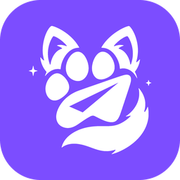

<p align="center"></p>

# MelloGram

A customisable Telegram client for **Windows, Linux and Android** (iOS and
macOS from the same code), written in Rust. MelloGram brings the client-mod experience popularised by Vencord —
plugin manager, themes, QuickCSS, backup & restore — to Telegram, as a
first-class client instead of a patch.

> Unofficial. Not affiliated with Telegram. You sign in with your own API
> credentials from <https://my.telegram.org>.

## What's in 0.1

**Customization platform**

- **Appearance Studio** — bubble styles (rounded, squared, compact, glass,
  outline, flat), radius, spacing, gradients, wallpapers, per-chat
  overrides, fonts, density, avatars, scaling, animations, live preview.
- **Workspaces** — whole setups (plugins, settings, themes, CSS, appearance)
  you switch between instantly from the title bar or Ctrl+P.
- **Shareable profiles** — export a workspace as a file; imports are
  inspected first (plugins, permissions, CSS) and never overwrite your themes.
- **Privacy & Security** — app lock (PIN, auto-lock, lock on start),
  Privacy Mode blurs, Secret Guard, plugin permission overview.
- **Diagnostics** — local stats, plugin performance, a 16-check testing
  center, redacted support bundles, safe mode with crash detection.
- **Command palette** (Ctrl+P) for settings, chats, plugins, workspaces.

**Vencord-style core**

- **Plugin manager** — search, category and status filters, favourites,
  auto-generated settings panels, dependency handling, per-plugin error
  reporting, crashing plugins isolated and paused.
- **30 built-in plugins**, each declaring its permissions — including Link
  Scrubber, Text Replace, Quick Commands, Message History, Message
  Highlight, Secret Guard, Calculator, Privacy Mode, Chat Colorizer, Quick
  Notes, Bookmarks, Message Templates, Chat Statistics, Chat Export, Link
  Collection, Copy Enhancer, Silent Send/Typing, Local Pins and more.
- **Themes** — install from file, URL or scratch; order them; edit their
  `--variables` with colour pickers. Three bundled themes.
- **QuickCSS** — live CSS editor.
- **Backup & Restore** — one JSON file; Telegram credentials never exported.
- **MelloRPC core** — native length-prefixed protocol model, Discord IPC packet decoder, Rich Presence translation and short-lived activity leases (transport listener is staged separately).
- **MelloID** — dedicated profile studio with structured Bio Studio sections, banner/avatar/accent customization, profile visibility, connection cards, live preview, JSON backup, static public HTML export, badge showcase, and a versioned local identity store. Public hosting, OAuth verification, and live RPC are staged separately.\n- **Telegram** — phone + code + 2FA login, chat list, history with infinite
  scroll, send/reply/edit/delete, file attachments by drag & drop, live updates.

See [docs/CREDENTIALS.md](docs/CREDENTIALS.md) for API ID/hash setup.\n\nSee [docs/FEATURES.md](docs/FEATURES.md) for the Vencord → MelloGram map and
[docs/PLATFORM.md](docs/PLATFORM.md) for the full customization-platform
spec status.

## Architecture

```
mellogram/
├── crates/
│   ├── mellogram-core       plugin trait + manager, settings, themes (no network, no UI)
│   ├── mellogram-plugins    built-in plugins (Rust) + their UI halves (ui/*.js)
│   └── mellogram-telegram   Telegram backend on grammers (pure-Rust MTProto)
├── app/
│   ├── src-tauri            desktop shell: commands, event pump, bundling
│   └── ui                   HTML/CSS/JS front end (no build step)
├── themes/                  bundled example themes
└── docs/                    features, plugin API, theming, roadmap
```

- **Why Tauri:** themes and QuickCSS are real CSS, so the UI is a webview
  (WebView2 on Windows, WebKitGTK on Linux) while everything else is Rust.
- **Why grammers:** pure Rust, no C++ TDLib to cross-compile.
- Plugins run on the backend for anything touching messages, so they are
  testable without a network; UI halves only add buttons and renderers.

## Building

Prerequisites: Rust 1.80+, and the [Tauri system dependencies](https://v2.tauri.app/start/prerequisites/).

Linux (Debian/Ubuntu):

```bash
sudo apt install libwebkit2gtk-4.1-dev libgtk-3-dev librsvg2-dev libayatana-appindicator3-dev patchelf
```

Windows: WebView2 (preinstalled on Windows 10/11) and the MSVC build tools.

Then, from `mellogram/`:

```bash
cargo install tauri-cli --version "^2" --locked
```

```bash
cd app/src-tauri && cargo tauri dev
```

Release installers (`.deb`, `.rpm`, `.AppImage` on Linux; `.msi` and NSIS
`.exe` on Windows):

```bash
cd app/src-tauri && cargo tauri build
```

Windows installers: on Windows, `cargo tauri build` produces an NSIS
`.exe` (per-user or all-users install, Start-menu entry, uninstaller,
WebView2 bootstrapper embedded) and a WiX `.msi` for managed deployment.
From Linux you can cross-build the `.exe` installer with MinGW:

```bash
sudo apt install mingw-w64 nsis && rustup target add x86_64-pc-windows-gnu
```

```bash
cd app/src-tauri && cargo tauri build --target x86_64-pc-windows-gnu --bundles nsis
```

Android (needs the Android SDK + NDK and the Android Rust targets):

```bash
cd app/src-tauri && cargo tauri android init && cargo tauri android build --apk
```

Tests:

```bash
cargo test --workspace --exclude mellogram
```

CI (`.github/workflows/mellogram.yml`) runs the tests, then builds Linux
packages, Windows `.exe` + `.msi` installers, an Android APK/AAB, and an
iOS compile check, uploading installers as artifacts.

If a plugin or theme ever breaks the UI, start in **safe mode**
(`--safe-mode` or `MELLOGRAM_SAFE_MODE=1`, or from the banner MelloGram
shows after an unclean exit).

## First run

1. Create an app at <https://my.telegram.org> → *API development tools*.
2. Paste the API ID and hash into MelloGram.
3. Sign in with your phone number, the code Telegram sends, and your 2FA
   password if you have one.

Data lives in the per-user config directory (`%APPDATA%\app.mellogram.desktop`
on Windows, `~/.config/app.mellogram.desktop` on Linux): `settings.json`,
`telegram.session` (keep it private — it is your login) and `themes/`.

## License

GPL-3.0-or-later. MelloGram is an independent implementation; it contains no
Vencord or Telegram Desktop code.
"# MelloGram" 
